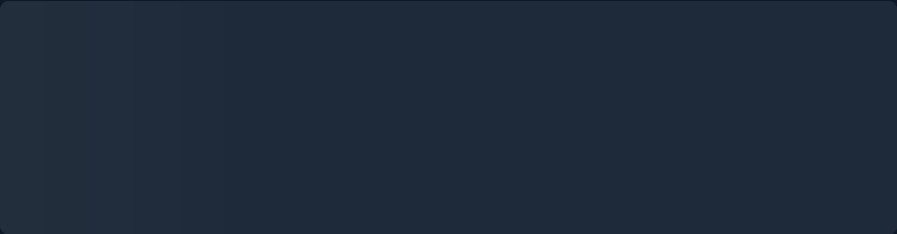
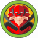
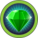
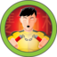
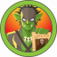
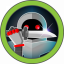

# 🌱 Mattia Bennati - Scrayil
> **IT Engineer · Offensive Security · Lighting Control Systems · Animal Rights Advocate**

I'm a computer engineer pursuing a master's degree in AI at the University of Florence while working part-time as a lighting control systems engineer for architectural installations worldwide.

In my free time:
- 🐮 Building **[VegStyle™](https://github.com/vegstylecio)**, a nonprofit project: Go/gRPC backend and Flutter client
- 🧩 Maintaining **[joplin-plugin-projects](https://github.com/Scrayil/joplin-plugin-projects)**, a Joplin plugin used by the community
- 🔓 Working toward the **CPTS** certification - currently Professional rank on Hack The Box

 

&nbsp;&nbsp;&nbsp;&nbsp;&nbsp;
&nbsp;&nbsp;&nbsp;&nbsp;&nbsp;
&nbsp;&nbsp;&nbsp;&nbsp;&nbsp;
<!--&nbsp;&nbsp;&nbsp;&nbsp;&nbsp;-->

---
### ⚒️ Languages and tools I use

    
    
    
    
    
    <picture>
      <source media="(prefers-color-scheme: dark)" srcset="https://cdn.simpleicons.org/django/white">
      
    </picture>
    
    
    
    
     
    
    

---
### 👨🏻‍💻 HTB

  

---
### 📈 Stats

---
### 🪪 Badges

  

---

    
🎯 Rooted Machines

<!-- HTB Activities-Start -->
 
    
    
    
    
    
    
    
    
    
    
    
    
    
    
    
    
    
    
    
    
    
    
    
    
    
    
    
    
    
    
    
    
    
    
<!-- HTB Activities-Stop --> 

